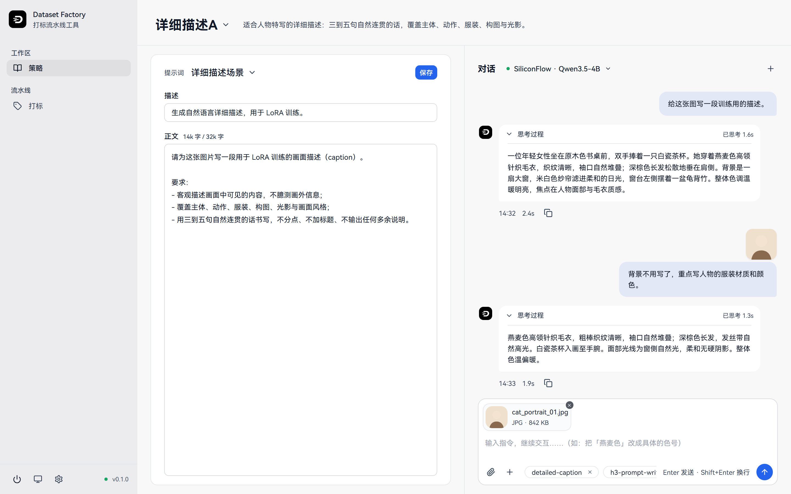
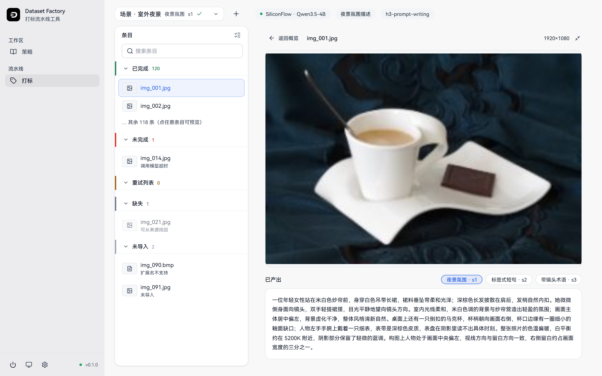

# Dataset Factory

> 本地运行的 AI 打标流水线：把图片和视频素材交给大模型，批量产出 LoRA 训练所需的 caption，再打包成训练器可直接使用的数据集。

[](https://github.com/daybreakerx/dataset-factory/actions/workflows/ci.yml)
[](LICENSE)
[](https://www.python.org/)






## 这是什么

训练 LoRA 模型最耗时的环节往往不是训练本身，而是准备素材描述（caption）：几十上百张图片要逐张写提示词，写得风格不一致、改了方向还要返工，靠手动复制粘贴很容易乱。Dataset Factory 把这件事做成一条流水线——**导入 → 打标 → 复核 → 打包导出**，核心打标环节交给任何 OpenAI 兼容的大模型（你自己配置端点，按自己的 token 计费），你只负责定规则、抽检和兜底。

工具完全在本地运行，数据落在你自己的磁盘上（纯文件存储，不依赖任何数据库或云服务）；同时提供 Web 界面和命令行（`dsf`）两个对等入口，手动使用和脚本/Agent 自动化都走同一套能力。

它不替你做素材筛选、切片、归类这些前置工作——进入流水线的素材默认是你已经准备好的；它专注做好"打标"这一段。

## 功能特性

### 对话式打标

给模型发一张图、一句指令，就能产出 caption，之后可以像聊天一样继续让它迭代："背景不用写，重点写服装材质和颜色"。支持图片和视频（视频自动抽帧后按整体片段描述），回复流式输出，模型的思考过程折叠在消息上方可展开查看；图片、多条指令可以随消息附带。

### 批量打标流水线

把素材文件夹接入为**工作目录**（支持 `批次/人物/场景/来源` 三级层级），以批次为单位发起无人值守打标：单图批次、图片+视频混批、纯视频批次都支持。每个条目在名单里有明确状态（已完成、未完成、重试、缺失、未导入），调用超时、额度不足、限流、连接失败等失败会自动重试、可换模型重跑；素材被移走或改名能找回、扩展名不支持或未导入的文件单独列出，还可以一键清理批次中未导入的条目。

### 策略库与提示词库

把一个提示词、一个端点和一组 Skill 组合保存为**策略**，打标时在顶栏实时切换，模型行为随之整体变化。同一个条目用不同策略产出的 caption 并排展示，方便横向对比挑选。策略可以编辑、复制，引用失效时能重新指定；保存时同名会自动改名，已应用于批次的策略会留下快照、不受后续修改影响。更早的提示词库也完整保留，在对话顶栏即可选用。

### Agent Skill 扩展

Skill 是遵循 agentskills.io 标准的自定义技能包（操作约定/流程规范，Markdown 形式），通过会话上下文约束模型行为，例如要求模型按特定格式输出、遵循特定拍摄术语。可以从文件夹导入、在会话级或全局启停，由外部 Agent 调用 API 时同样生效。

### 任意 OpenAI 兼容端点

不绑定任何模型厂商：配置 OpenAI 兼容的 `base_url`、API Key 和模型 ID 即可使用（OpenAI、SiliconFlow、本地 vLLM/Ollama 等），支持同时配置多个端点随时切换，并提供连通性测试（`dsf config test`）与请求参数调整。

### 一键打包导出

打标结果按训练器通用的扁平结构打包为 ZIP：图片与同名 `.txt` 同放一根目录，`.txt` 与 `.caption` 双格式同时产出（kohya-ss 与 NovaCube 两家训练器都兼容），附带 `manifest.json` 记录清单与哈希。可按批次、按策略筛选导出范围，导出前可预览，导出后可从清单重新打开。

### 对等的 Web 与 CLI 双入口

Web 界面提供完整的可视化工作流；命令行 `dsf` 覆盖同等能力，适合批量任务和外部 Agent 编排——Web 里能做的配置、打标、导出，CLI 都能做，输出适合管道处理。

### 其他

- **数据完全本地**：工作数据保存在 `~/.dataset_factory/`（可用环境变量 `DATASET_FACTORY_HOME` 改位置），纯 JSONL/文本文件，可读、可备份、可迁移。
- **亮暗双主题与响应式布局**：桌面端左右分栏高效工作，窄屏（<768px）自动切换为上下堆叠、列表可展开收起。
- **跨平台**：Windows 与 Linux 一等支持，提供一键启动与停止脚本（macOS 可使用 Linux 脚本）。

## 快速开始

### 环境要求

- [uv](https://docs.astral.sh/uv/)（Python 包管理器，后端依赖与启动都依赖它；Python 3.12 由 uv 自动准备）
- Node.js 20+ 与 npm（仅首次构建前端需要；之后启动无需 Node）

### 一键启动（推荐）

Windows：

```bat
start.bat
```

Linux / macOS：

```bash
chmod +x start.sh
./start.sh
```

脚本会自动同步后端依赖、首次运行时构建前端，然后后台启动服务并打开浏览器（Windows 脚本默认端口 5731，Linux/mac 脚本默认 8000，均可修改）。关闭服务用页面左上角的电源按钮，或运行 `stop.bat` / `./stop.sh`。

### 手动启动

```bash
# 后端依赖
cd backend && uv sync

# 前端构建（也可以 cd frontend && npm run dev 起开发服务器）
cd ../frontend && npm install && npm run build

# 启动服务（默认 http://127.0.0.1:8000）
cd ../backend && uv run dsf serve
```

### 上手三步

1. 打开页面后进入设置，添加一个 OpenAI 兼容端点（`base_url`、API Key、模型 ID），可点「检查」确认连通。
2. 在打标页新建工作目录，指向你准备好的素材文件夹，导入为批次。
3. 在顶栏选择提示词（策略）与端点，发起单条对话打标或整批无人值守打标；完成后用导出功能打包 ZIP。

## CLI 用法

所有命令都在 `backend/` 目录下以 `uv run dsf ...` 运行，或安装后直接使用 `dsf`。

| 命令 | 用途 |
| --- | --- |
| `dsf serve` | 启动本地 Web 服务（HTTP API + 界面） |
| `dsf label` / `dsf chat` | 单图打标 / 终端多轮对话打标（`--session` 续接即迭代改写） |
| `dsf run` | 前台执行批次无人值守打标，Ctrl-C 安全收尾 |
| `dsf workdir add/show/import/reimport/relocate/verify/cleanup/list/rm` | 工作目录的登记导入、缺失找回、迁移、校验与清理 |
| `dsf batch items/status/stop/retry/exclude/hide/rm` | 批次条目状态、停止、重试、打包排除与删除 |
| `dsf strategy add/list/show/use/edit/copy/rebind/rm` | 策略库（端点 + 提示词 + Skill 的组合）管理 |
| `dsf prompt list/show/save/rename/rm` | 提示词库管理 |
| `dsf skill import/list/enable/disable/read/rm` | Agent Skill 导入与启停 |
| `dsf export plan/run` | 导出前预览（入包/排除清单）与打包 ZIP |
| `dsf config add/list/set/test/params/remove` | 端点配置、连通性测试与高级请求参数 |
| `dsf session list/show/remove` | 对话会话管理 |

任意命令加 `--help` 查看参数；`dsf` 退出码在 `--help` 末尾有完整约定。

## 项目结构

```
.
├── backend/                 # FastAPI 后端 + dsf 命令行（Python 3.12，uv 管理）
│   ├── src/dataset_factory/  # 分层：cli > api > runs > labeling > 策略 > 工作目录 > 能力 > 数据域
│   ├── tests/               # pytest 单元/集成测试
│   └── docs/                # MkDocs 工程文档（API 说明等）
├── frontend/                # React 19 + Vite + TypeScript + Tailwind + shadcn/ui
├── e2e/                     # Playwright 端到端测试（真实浏览器 + 真实后端 + 假模型端点）
├── scripts/                 # 验收与质量门禁脚本
├── .github/workflows/       # CI（Windows + Linux 双矩阵）
├── start.bat / start.sh     # 一键启动
└── stop.bat / stop.sh       # 一键停止
```

## 工程特点

- **分层架构带强制门禁**：核心业务库不依赖任何入口层（Web 与 CLI 都只是入口），Python 侧用 import-linter、前端用 dependency-cruiser 把依赖方向固化在 CI 里；另有 knip / depcheck 清理未使用依赖。
- **OpenAPI 是前后端唯一契约**：前端 API 客户端从 OpenAPI 生成，oasdiff 在 CI 中拦截破坏性变更，杜绝「前后端字段对不上」。
- **测试金字塔**：pytest 后端测试带覆盖率门禁，mutmut 变异测试持续度量测试有效性；Vitest 覆盖前端逻辑；Playwright 跑真实浏览器到真实后端的全链路（对打标模型用本地假端点，测试稳定不花 token）。
- **类型与风格自动化**：后端 pyright strict 严格类型检查 + ruff 格式化与 lint，前端 Biome 统一风格，pre-commit 提交前自动执行；detect-secrets 防止密钥入库。
- **纯文件存储**：没有数据库，所有状态为 JSONL 与文本文件，损坏时可手动检查、版本管理与备份都简单。

## 当前状态

- **v0.1.0（已发布）**：单条对话打标、流式输出与思考过程、视频打标、提示词库、Skill 库、多端点接入。
- **v0.2.0（main 分支已合入，Release 待发布）**：工作目录与批次、混批无人值守打标、条目级状态监控与失败重试、策略库、打包导出、CLI 与 Web 全功能对等。
- **下一步（规划中）**：复核与交付阶段（人工复核工作流、批量改标、交付检查单等）。

## License

[MIT](LICENSE)
